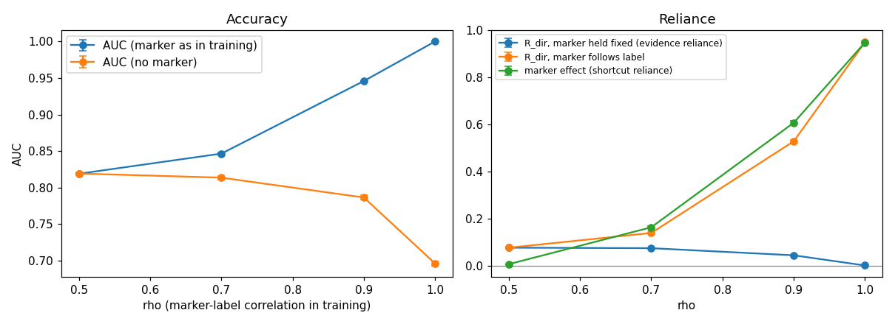

# Accuracy Is Not Reliance: Evidence Reliance in Medical Vision-Language Models

## What I measure

A model can be accurate without using the evidence in the image. I wanted to measure how much a model's answer
depends on that evidence. I use real chest X-rays of the same patient taken at different times:

- an **anchor** image *a*;
- a **flip partner** *f*, where a finding (e.g. pleural effusion) appears or disappears;
- a **control pair** (*s₁*, *s*) of the same patient, where the finding does not change, taken at **exactly the same time gap**.

```
D_flip = E[(p(f) − p(a)) · Δy]        Δy = +1 if the finding appears, −1 if it disappears
D_ctrl = E[(p(s) − p(s₁)) · Δy]
R_dir  = D_flip − D_ctrl
```

`R_dir` asks whether the model's score moves toward the new label more than it moves on a same-patient, same-gap pair
where nothing changed. `R_sign` is the same with `sign(·)` and only counts the direction. Confidence intervals come from
a patient-level bootstrap. Labels are only used to set the direction of the change, never to grade answers.

## Main results

**1. The time-matched control is necessary** (simulation, model that ignores the evidence, n = 400, 300 repeats):

| Control | False-positive rate (nominal 2.5%) |
|---|---|
| none | 100% |
| control at a different time gap | 47% |
| **control at the same time gap (this work)** | **2%** |

**2. A planted shortcut separates accuracy from reliance** (DenseNet fine-tuned on NIH with a marker that matches the label in a fraction ρ of images):

| ρ | AUC (marker as in training) | R_dir, marker held fixed | Marker effect |
|---|---|---|---|
| 0.5 | 0.82 | 0.076 [0.058, 0.095] | 0.006 |
| 0.9 | 0.95 | 0.043 [0.031, 0.057] | 0.61 |
| 1.0 | **1.00** | **0.000 [−0.004, 0.004]** | 0.95 |



**3. Medical VLMs on NIH ChestX-ray14** (Effusion, 400 patients, prompt "Is there a pleural effusion in this chest X-ray? Answer yes or no."):

| Model | R_dir [95% CI] |
|---|---|
| MedGemma-4B | 0.160 [0.094, 0.225] |
| CheXpert DenseNet (positive control, 1,445 patients) | 0.063 [0.041, 0.082] |
| Qwen2.5-VL-7B | 0.001 [−0.006, 0.008] |

Qwen2.5-VL-7B was near zero on all four findings I tested, and on three wordings of the effusion question.

**4. A fake prior report overrides the image.** With "Prior radiology report: pleural effusion is present." added to the
prompt, MedGemma-4B answered "yes" for every image (R_dir 0.000). With "no pleural effusion" it still used the image
(R_dir 0.162). Qwen2.5-VL-7B followed the report (text effect 0.44) and ignored the image in every condition.

**Limitations** (details in Section 8 of the report): NIH labels are text-mined and noisy, so real-data estimates are
probably underestimates; two VLM families and one dataset; R_dir on the probability scale shrinks near 0 and 1;
no formal identification proof.

## Repository layout

```
pilot_lib.py                 pair construction, estimators, bootstrap (shared by all notebooks)
notebooks/
  01_feasibility.ipynb              how many usable patients each finding has (NIH, CheXTemporal)
  02_positive_control_and_vlms.ipynb  first run: DenseNet, Qwen2.5-VL-3B/7B, time-matched pair controls
  03_diagnostic_directional.ipynb   label-noise diagnostic, directional estimand, MedGemma
  04_robustness_sweep.ipynb         4 findings x 3 models, 3 prompt wordings, yes/no-mass filter
  05_planted_shortcuts.ipynb        Arm A: planted image marker; Arm B: fake prior report
  06_simulation_study.ipynb         simulation with known ground truth (CPU only, already executed)
results/                     summary tables and figures written by each notebook
data_derived/                anchor lists and raw model scores (lets you recompute results without a GPU)
scripts/reproduce_table2.py  recomputes report Table 2 from data_derived/ in seconds
report/                      technical report (PDF)
```

## How to reproduce

**Without a GPU (seconds):**
```bash
pip install -r requirements.txt
python scripts/reproduce_table2.py      # recomputes Table 2 of the report from saved scores
```

Expected output (`R_dir` with its 95% interval; `R_sign` only counts the direction of movement):

```
     finding                  model anchors mass_filter  n_patients  R_dir     lo    hi  R_sign
    Effusion    DenseNet (CheXpert)     all           -        1445  0.063  0.041 0.082   0.176
    Effusion Qwen2.5-VL-7B-Instruct     vlm           -         400  0.001 -0.006 0.008   0.045
    Effusion Qwen2.5-VL-7B-Instruct     vlm         0.9         400  0.001 -0.006 0.008   0.045
    Effusion         medgemma-4b-it     vlm           -         400  0.160  0.094 0.225   0.262
    Effusion         medgemma-4b-it     vlm         0.9         312  0.167  0.101 0.237   0.276
 Atelectasis    DenseNet (CheXpert)     all           -        1341  0.047  0.028 0.065   0.101
 Atelectasis Qwen2.5-VL-7B-Instruct     vlm           -         400 -0.009 -0.033 0.014  -0.048
 Atelectasis Qwen2.5-VL-7B-Instruct     vlm         0.9         400 -0.009 -0.033 0.014  -0.048
 Atelectasis         medgemma-4b-it     vlm           -         400  0.061  0.026 0.099   0.200
 Atelectasis         medgemma-4b-it     vlm         0.9         294  0.000 -0.000 0.000   0.075
Pneumothorax    DenseNet (CheXpert)     all           -        1034  0.016 -0.000 0.030   0.048
Pneumothorax Qwen2.5-VL-7B-Instruct     vlm           -         400 -0.002 -0.004 0.001  -0.100
Pneumothorax Qwen2.5-VL-7B-Instruct     vlm         0.9         400 -0.002 -0.004 0.001  -0.100
Pneumothorax         medgemma-4b-it     vlm           -         400  0.059 -0.004 0.122   0.038
Pneumothorax         medgemma-4b-it     vlm         0.9         297  0.060 -0.006 0.125  -0.003
Cardiomegaly    DenseNet (CheXpert)     all           -         740  0.028 -0.001 0.054   0.078
Cardiomegaly Qwen2.5-VL-7B-Instruct     vlm           -         298  0.006 -0.025 0.038   0.060
Cardiomegaly Qwen2.5-VL-7B-Instruct     vlm         0.9         298  0.006 -0.025 0.038   0.060
Cardiomegaly         medgemma-4b-it     vlm           -         298  0.114  0.050 0.183   0.215
Cardiomegaly         medgemma-4b-it     vlm         0.9         175  0.046 -0.006 0.103   0.126
```

The `mass_filter` column is the minimum share of next-token probability that "yes" and "no" must hold on all four images of a patient (`-` = no filter). Rows with `0.9` keep only patients where the model gave a clean yes/no answer.

Notebook 06 (simulation) runs on any CPU in about two minutes and needs no data. Seeds are fixed; a rerun on Kaggle gave identical numbers.

**Full pipeline (Kaggle, GPU T4 x2):** each notebook needs
1. the dataset **NIH Chest X-rays** (`nih-chest-xrays/data`, Add Input → Datasets);
2. Internet on;
3. for MedGemma: accept its licence on Hugging Face and add a Kaggle secret `HF_TOKEN`.

Notebooks 04 and 05 can reuse the scores of the previous notebook if you attach its output as an input.
Approximate GPU time: notebook 03 ~4 h, 04 ~9 h (I ran it in two sessions), 05 ~3–4 h. Qwen2.5-VL-7B took about 0.9 s per image and MedGemma-4B (float32) about 3.8 s per image on a T4.

## Data and models

- NIH ChestX-ray14 (Wang et al., CVPR 2017), via Kaggle.
- CheXTemporal labels (Hugging Face, CC-BY-NC) are only counted in notebook 01; no labels are redistributed here.
- TorchXRayVision DenseNet-121 trained on CheXpert (Cohen et al., MIDL 2022); Qwen2.5-VL (Bai et al., 2025); MedGemma (Sellergren et al., 2025).
- `data_derived/` contains NIH image file names, labels copied from the NIH metadata, and model scores.

## License

Code: MIT (see `LICENSE`). Derived data follow the terms of the original datasets.
